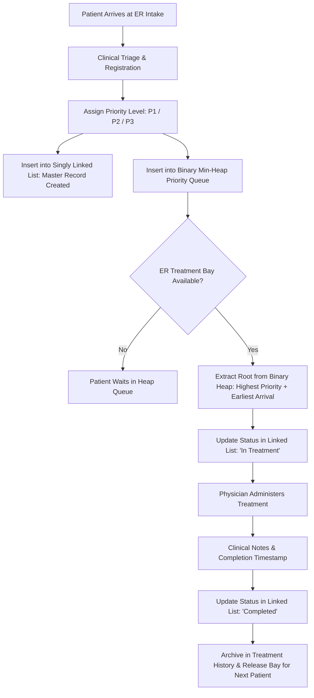

# Hospital Emergency Management System (MediCare ER)
### Enterprise Emergency Triage and Clinical Patient Queue Management System

A complete, high-performance, and visually modern **Hospital Emergency Triage and Patient Queue Management System** developed in Python using **CustomTkinter**.

The system demonstrates genuine, robust implementations of fundamental data structures:
* **Custom Singly Linked List (`PatientLinkedList`)**: Authoritative dynamic memory patient record storage.
* **Custom Priority Queue (`PriorityPatientQueue`)**: Binary Min-Heap with secondary arrival sequence tie-breaking.
* **FIFO Queue (`PatientQueue`)**: First-In, First-Out pointer-linked node queue for equitable patient scheduling.

---

## 1. Problem Statement

In an emergency medical environment, patients arrive unpredictably with varying degrees of medical urgency ranging from critical cardiac arrest to minor sprains. Standard First-Come, First-Served (FCFS) scheduling risks human lives by forcing life-threatening trauma cases to wait behind non-urgent outpatient visits.

Conversely, a pure priority queue without arrival tracking leads to starvation of lower-priority patients or unfair arbitrariness when multiple patients present with identical urgency.

This system delivers an algorithmic triage management solution that enforces strict clinical prioritization while preserving equitable First-In, First-Out ordering among patients of equivalent severity.

---

## 2. Key Objectives

1. **Emergency Prioritization**: Critical emergency patients (Priority 1) are treated before high priority (Priority 2), who are treated before normal patients (Priority 3).
2. **Stable FIFO Tie-Breaking**: Equal priority patients are always dispatched in strict order of arrival.
3. **Dynamic In-Memory Records**: Master patient records are dynamically allocated and traversed using a custom Singly Linked List.
4. **Complete Treatment Lifecycle**: Moving patients through Intake → Waiting Heap → Active Treatment Bay → Completed Treatment History.
5. **Medical Governance**: Completed patients are archived in records with clinical notes and duration metrics, never discarded.
6. **Data Persistence**: Safe atomic JSON persistence preserves all states across system restarts.

---

## 3. UI/UX Design & Architecture

Inspired by modern clinical administration dashboards:
* **Left Fixed Sidebar**: Medical brand identity, active page highlights, status indicator, and system details.
* **Top Navigation Bar**: Live real-time clock, triage status indicator, quick "+ Register Patient" action, and physician profile chip.
* **Dashboard Hero Card**: Prominent **"NOW SERVING IN ACTIVE EMERGENCY BAY"** display with real-time treatment timer and direct discharge action.
* **Priority Distribution**: Embedded Matplotlib Donut Chart visualizing critical vs. high vs. normal patients.
* **Dynamic Table Views**: Rounded card rows with color-coded priority pill badges:
  * 🚨 **Critical Emergency (Priority 1)**: Medical Red (`#DC2626`)
  * ⚠️ **High Priority (Priority 2)**: Urgent Amber (`#D97706`)
  * 🟢 **Normal Priority (Priority 3)**: Stable Emerald (`#059669`)

---

## 4. Software Architecture

```
Emergency Hospital Management System/
│
├── main.py                     # GUI entry point, navigation controller, and event loop
├── requirements.txt            # Project dependencies
├── README.md                   # System documentation & technical guide
│
├── data_structures/            # Custom Data Structures
│   ├── __init__.py
│   ├── patient_linked_list.py  # Singly Linked List with dynamic PatientNode allocation
│   ├── patient_queue.py        # Pointer-linked FIFO Queue
│   └── priority_queue.py       # Binary Min-Heap Priority Queue with FIFO tie-breaker
│
├── models/                     # Entity definitions
│   ├── __init__.py
│   └── patient.py              # Patient entity, priority levels, and serialization
│
├── services/                   # Business logic layer
│   ├── __init__.py
│   ├── hospital_service.py     # Triage workflows, queue coordination, stats calculation
│   └── storage_service.py      # Atomic JSON persistence & state reconstruction
│
├── ui/                         # Modular CustomTkinter GUI views
│   ├── __init__.py
│   ├── theme.py                # Cohesive clinical color palette & design tokens
│   ├── components.py           # Stat cards, pill badges, modals, alert banners
│   ├── dashboard.py            # Overview metrics, hero bay banner, donut chart
│   ├── registration.py         # Patient intake form with inline validation
│   ├── emergency_queue.py      # Prioritized queue table with binary heap root callout
│   ├── patient_records.py      # Linked List master records & pointer visualizer
│   ├── treatment.py            # Active emergency bay & clinical discharge notes
│   ├── treatment_history.py    # Completed care archives with CSV export
│   └── about_page.py           # Architecture overview & live runtime DSA inspector
│
├── data/
│   └── patients.json           # Atomic persistent data storage
│
└── tests/                      # Automated unit test suite
    ├── test_data_structures.py # Unit tests for Linked List, FIFO Queue, and Heap
    └── test_hospital_service.py# End-to-end lifecycle & triage tests
```

---

## 5. Algorithmic Implementation Details

### A. Priority Queue with Binary Min-Heap (`PriorityPatientQueue`)
* Elements stored as tuples: `(priority_level, arrival_sequence, patient)`.
* **Primary Key**: `priority_level` (1 for Critical, 2 for High, 3 for Normal).
* **Secondary Key**: `arrival_sequence` (strictly incrementing integer: 1, 2, 3...).
* **Comparator Logic**:
  ```python
  def _compare(self, a, b):
      if a[0] != b[0]:
          return a[0] < b[0]    # Lower number = Higher emergency urgency
      return a[1] < b[1]        # Lower arrival sequence = Arrived earlier (FIFO)
  ```
* Sift-up on insertion and sift-down on extraction maintain the min-heap invariant.

### B. Singly Linked List (`PatientLinkedList`)
* Each `PatientNode` stores a `patient` reference and a `next` pointer.
* Serves as the master repository for all patient records throughout their hospital journey.
* Inserting at tail executes in $O(1)$ using an internal tail pointer.
* Deletion searches for the target ID in $O(n)$ and updates the prior node's pointer:
  ```python
  prev.next = curr.next
  curr.next = None
  ```

---

## 6. Time and Space Complexity Analysis

| Data Structure | Operation | Time Complexity | Space Complexity | Technical Rationale |
| :--- | :--- | :---: | :---: | :--- |
| **Binary Min-Heap** | `insert()` | $O(\log n)$ | $O(n)$ | Adds element at leaf and sifts up along tree height $\log_2(n)$ |
| **Binary Min-Heap** | `pop_highest_priority()` | $O(\log n)$ | $O(1)$ extra | Swaps root with last leaf and sifts down to restore heap property |
| **Binary Min-Heap** | `peek()` | $O(1)$ | $O(1)$ | Constant-time inspection of root node at index 0 |
| **Binary Min-Heap** | `remove_by_id()` | $O(n) + O(\log n)$ | $O(1)$ | Linear scan to find element index + heap restoration |
| **Singly Linked List**| `insert_patient()` (Tail)| $O(1)$ | $O(1)$ per node | Instant pointer reassignment via maintained `self.tail` pointer |
| **Singly Linked List**| `insert_at_head()` | $O(1)$ | $O(1)$ | Direct update of `self.head` pointer |
| **Singly Linked List**| `search_patient()` | $O(n)$ | $O(1)$ | Sequential traversal across linked node chain |
| **Singly Linked List**| `update_patient()` | $O(n)$ | $O(1)$ | Traversal to locate node + constant-time field modification |
| **Singly Linked List**| `delete_patient()` | $O(n)$ | $O(1)$ | Linear scan with predecessor pointer relinking |
| **FIFO Node Queue** | `enqueue()` / `dequeue()` | $O(1)$ | $O(1)$ per node | Constant time updates via `self.front` and `self.rear` |

---

## 7. Emergency Triage Workflow



---

## 8. Installation & Running Instructions

### Prerequisites
* Windows 10/11
* Python 3.10+ installed

### Step 1: Install Dependencies
Open PowerShell or Command Prompt in the project folder:
```powershell
pip install -r requirements.txt
```
*(Dependencies: `customtkinter`, `pillow`, `matplotlib`)*

### Step 2: Run Automated Unit Tests
Verify data structures and business logic correctness:
```powershell
python -m unittest discover tests
```

### Step 3: Launch the Application
```powershell
python main.py
```

---

## 9. System Specifications
* **Project Name**: Hospital Emergency Management System (MediCare ER)
* **Domain**: Healthcare Triage & Queue Management
* **Framework**: CustomTkinter
* **Edition**: Enterprise Healthcare Edition v2.4
# Emergency-Hospital-Management-System

